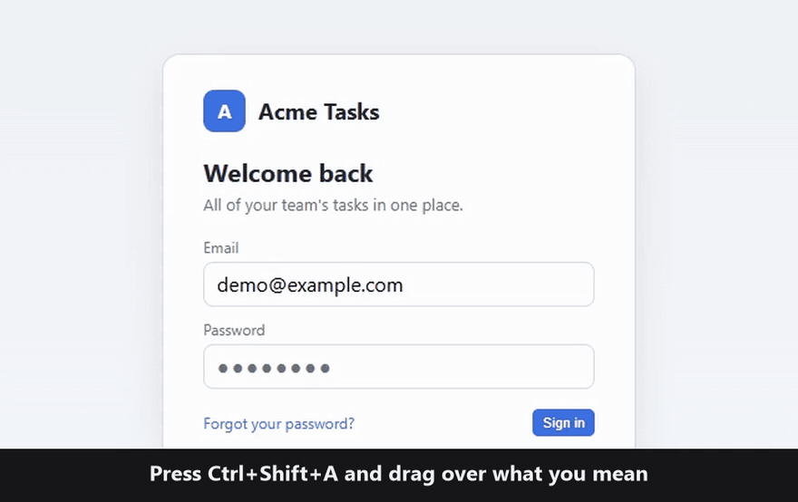

<p align="center"></p>

<h1 align="center">Backseat</h1>

<p align="center">
  <b>Mark what to fix on your screen, explain it out loud, and hand it to your AI coding tool.</b>
</p>

<p align="center">
  <a href="https://github.com/JJFlo-kr/backseat/releases/latest"><b>Download for Windows</b></a>
  ·
  <a href="https://jjflo-kr.github.io/backseat/"><b>Watch the demo</b></a>
  ·
  <a href="README.ko.md">한⁠국⁠어</a>
</p>

<p align="center"><sub>Windows 10 (64-bit) · free · open source (MIT)</sub></p>

<p align="center">
  
</p>
<p align="center">
  <sub>Real app, driven by a script; the voice is text-to-speech; the edit was made by Codex CLI in one real run.
  <a href="https://jjflo-kr.github.io/backseat/">1-minute video with sound</a></sub>
</p>

## Getting started

1. **Install.** Download `Backseat Setup <version>.exe` from [Releases](https://github.com/JJFlo-kr/backseat/releases/latest)
   and run it. Backseat sits in the notification area and starts whenever you log in.
2. **Capture.** On the screen you want changed, press `Ctrl+Shift+A` and drag over the part you mean.
3. **Mark it up.** Draw arrows, numbers or circles. Press `M` to explain out loud while you draw, or just type a
   one-line note. Voice is optional.
4. **Send.** Press `Enter`. Backseat pastes it into the AI window you used last. Check it and submit it there.

Windows may warn about the installer the first time; see [Installing](#installing-and-the-windows-warning).

## What it does

- **Your marks and your words stay together.** Each sentence you say is linked to the mark you were drawing at
  that moment, so "make this bigger" arrives with the circle it was about.
- **It goes to the AI window you were using.** Backseat picks the AI tool you used last, not the page you just
  captured or a messenger. It checks the input box before pasting and shows only the steps it could confirm.
- **Speech is turned into text on your PC.** A local speech model (Whisper) transcribes your voice; nothing is
  sent to a speech service unless you set one up.

## Where it sends, and what arrives

| Destination | What gets pasted | Good to know |
|---|---|---|
| An AI agent in a terminal (Codex CLI, Claude Code, …) | A request line with the file paths of the marked-up image and a short request file (`brief.md`) | The agent must be able to read files on your PC. Tested end to end with Codex CLI; not yet with Claude Code. |
| Code editors (Cursor, VS Code, Windsurf, Zed) | The same request line, into whatever box has the focus, such as an AI extension's chat box or the built-in terminal | Same file access as above. Recognized by rule; not yet tested in a real editor. |
| Claude and ChatGPT desktop apps, AI chat tabs in a browser | The marked-up image and a request line | Apps with several input boxes often need a click and `Ctrl+V`. In one ChatGPT app test only the text arrived. |

If you send a capture without marks, voice or a note, only the image (or, in a terminal, its path) is pasted.
Any other window, a messenger included, can be chosen by hand with `Ctrl+T`. Backseat does not paste into a field
Windows reports as a password field; inside a terminal it cannot tell a password prompt apart.

## FAQ

<details>
<summary id="installing-and-the-windows-warning"><b>Installing, and the Windows warning</b></summary>

The installer is not code-signed yet, so Windows may show "Windows protected your PC". Before you run it, check
that the file is the official one: in PowerShell, run

```powershell
Get-FileHash "$env:USERPROFILE\Downloads\Backseat.Setup.0.5.0.exe" -Algorithm SHA256
```

and compare the result with the SHA-256 shown next to the file on the [release page](https://github.com/JJFlo-kr/backseat/releases/latest).
If they match, choose "More info" → "Run anyway". If they do not, do not run it and [tell us](https://github.com/JJFlo-kr/backseat/issues).
Turn off starting at login from the Backseat menu in the notification area.
</details>

<details>
<summary><b>What does the voice feature download, and where does my voice go?</b></summary>

The first time you record, Backseat downloads the speech model (Whisper small, about 0.9 GB) once. After that your
voice is transcribed on your PC. Only if you set up cloud speech recognition is audio sent to that service. What
you send to an AI tool is handled by that tool.
</details>

<details>
<summary><b>The transcript is wrong</b></summary>

The transcribed text can't be edited in the editor. If a word or two is wrong, type the correction in the one-line
memo at the bottom of the editor. If much of it is wrong, record again (`M`): the new recording replaces the old
one and its transcript, and resets any links you changed. The request file also tells the agent that the transcript
is automatic, so numbers and names may be wrong.
</details>

<details>
<summary><b>A sentence is linked to the wrong mark</b></summary>

Press `L` to open the timeline and drag the sentence's bar in the speech lane onto the bar of the mark it belongs
to. Drop it on empty space in the speech lane to go back to automatic linking.
</details>

<details>
<summary><b>Nothing was pasted</b></summary>

When Backseat cannot confirm the input box, it does not paste; the capture waits on the clipboard. Click the AI
window's input box and press `Ctrl+V`. The editor shows why it stopped.
</details>

<details>
<summary><b>Why doesn't it press Enter for me?</b></summary>

By default Backseat pastes but does not submit, so you can check what arrived first. You can turn on "Press Enter
after sending" in the notification-area menu; it is pressed only when both the destination and the input box were
confirmed.
</details>

<details>
<summary><b>Where are my captures saved? Which languages?</b></summary>

Each send is saved under `Pictures\Backseat\sessions`: the marked-up image, the original screenshot, `brief.md`,
and the recording with its transcript if you spoke. The app follows your Windows language (English, 한국어,
日本語, 简体中文, 繁體中文, Español, Português (Brasil), Deutsch, Français; others fall back to English); change it
from the notification-area menu → **Language**.
</details>

<details>
<summary><b>Shortcuts and editing tools</b></summary>

| Action | Key |
|---|---|
| Capture a region / a window | `Ctrl+Shift+A` / `Ctrl+Shift+W` — switch with R / W / F / S in the selector |
| Scrolling capture of a long page | `S` in the selector, then click the window — `Esc` stops |
| Tools | Pen P · Text T · Arrow A · Rectangle R · Number N · Blur B · Crop C · Eraser E |
| Colors | Color button: palettes, recent colors, any color, eyedropper |
| Text style | Background box, outline or plain · box color and opacity · shadow · bold / italic |
| Text | `Enter` finishes · `Shift+Enter` new line · `Esc` cancels · double-click to edit |
| Voice | `M` starts and stops recording |
| Timeline | `L` opens it · `Space` plays · `End` jumps to now · save the replay as a video with `Ctrl+E` |
| Before/after | Capture again with "Recapture last region" in the tray, then `O`: overlay, split or difference |
| Change where it goes | Click the target bar or press `Ctrl+T`; pin a window as the default target |
| Undo / redo | `Ctrl+Z` / `Ctrl+Shift+Z` |
| Send · save · copy | `Enter` · `Ctrl+S` · `Ctrl+C` |

Marks you add are tagged so the AI can tell them from the real screen, and the original screenshot is sent along.
</details>

## Optional: let an agent fetch captures itself (MCP)

You do not need this to use Backseat. Set it up if your agent supports MCP and you want it to pull captures on its
own, or to ask you to draw an answer.

| | Without MCP (default) | With MCP |
|---|---|---|
| How a capture reaches the agent | Pasted into the AI window | The pasted line asks the agent to fetch it, or the agent fetches the latest one itself |
| What the editor can tell you | "Paste attempted" | Also "The AI fetched the capture" |
| The agent can ask you to draw | No | Yes |
| Setup | None | Node.js, plus one entry in the agent's MCP settings |

To set it up, right-click the Backseat icon → **Copy MCP connection settings** and paste it into your agent's MCP
configuration. It looks like this:

```json
{
  "mcpServers": {
    "backseat": {
      "command": "node",
      "args": [
        "C:/Users/<you>/AppData/Local/Programs/Backseat/resources/app.asar.unpacked/out/main/mcp-server.js"
      ]
    }
  }
}
```

Per-tool steps (Claude Code, Codex CLI, Cursor): [docs/MCP.md](docs/MCP.md).

## More

- About the name: from "backseat driver" — the AI drives, you sit in the back and point at the screen.
- Building from source, tests, speech settings and file formats: [docs/DEVELOPMENT.md](docs/DEVELOPMENT.md)
- Guide for AI coding agents working on this repository: [AGENTS.md](AGENTS.md)
- Design notes and history (Korean): [PLAN.md](PLAN.md)

## Support

Every feature of Backseat is free. If you would like to support its development:

[](https://buymeacoffee.com/jjflo)

## License

[MIT](LICENSE) © 2026 wowls2162. Open-source licenses of the components used:
[THIRD_PARTY_NOTICES.md](THIRD_PARTY_NOTICES.md).
